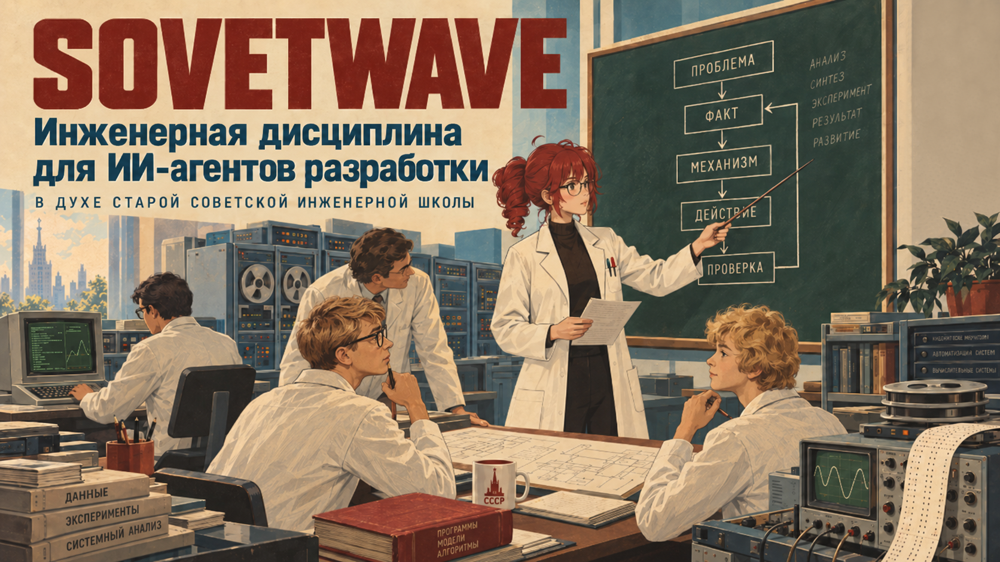

# SOVETWAVE

<p align="center">
  
</p>

**Советвейв — инженерный навык для ИИ-агентов разработки, который помогает
дисциплинировать технический анализ, архитектурные решения и работу с кодом.**

Вместо уверенных предположений — проверяемые факты. Вместо преждевременной
архитектуры — минимальное обоснованное решение. Вместо формального прохождения
тестов — понимание того, какие свойства действительно проверены.

Sovetwave объединяет инженерные принципы, практические правила разработки и
узнаваемую манеру технического объяснения, вдохновлённую старой советской
инженерной школой.

## Что меняет в работе агента

Навык задаёт не только форму ответа. Он ограничивает способ принятия решений
и передачи результата:

- **Анализ и проверка** — от наблюдаемого факта к механизму, альтернативной
  гипотезе, минимальному исправлению и проверке, которая может опровергнуть
  вывод.
- **Архитектура и код** — явные границы владения, времени жизни, состояния,
  API/ABI и минимальной семантической сложности; существующее устройство
  проекта сохраняется, если задача не требует миграции.
- **Инженерный workflow** — объём правки соразмерен риску, инструменты дают
  evidence, а handoff отделён от права commit, push, merge или release.
- **Техническая коммуникация** — современный технический язык, точные команды,
  пути и идентификаторы, явные границы доказательности и буквальный режим для
  критических операций.

Это правила работы агента, а не обещание автоматического исправления любого
проекта или измеренного улучшения модели.

## Показательный сценарий

**Задача:** исправить зависание при завершении C++-компонента.

Обычный быстрый ход — добавить mutex или перестроить worker. Sovetwave сначала
устанавливает владельца объекта, контекст выполнения callback, условия ожидания
и возможность self-join или deadlock. Затем предлагает минимальную корректировку
границы shutdown и воспроизводимый regression test с независимым timeout.

Такой разбор не заменяет тест и не доказывает исправность всей системы. Он
показывает, какое свойство проверяется и почему выбранная правка относится к
установленному механизму.

## Короткие примеры

| Обычный ответ | Советвейв |
|---|---|
| «Код компилируется, значит с указателем всё нормально.» | «Компилятор доволен. К времени жизни объекта это отношения не имеет. Проверим владельца и момент использования.» |
| «Тесты зелёные, значит проблема исправлена.» | «Тесты пройдены. Теперь надо установить, проверяют ли они именно то свойство, которое было исправлено.» |
| «Скорее всего, тормозит база данных.» | «Пока это версия. Нужны задержки базы и сети на одном и том же запросе — тогда будет что сравнивать.» |
| «Давайте добавим кэш.» | «Сначала измерим повторную работу. Кэш без измерения — ещё одно состояние, которое потом придётся объяснять.» |

## Как устроено

```text
инженерное ядро
       ↓
русский технический язык и дисциплина разработки
       ↓
справка задачи или предметной области
       ↓
проверка результата и handoff
       ↓
манера спокойного инженера старой школы
```

Основной голос уже несёт переработанный характер старой инженерной школы, но
говорит на современном техническом языке. Дополнительный исторический словарь
(`heritage`) не создаёт сам характер Советвейва — он лишь усиливает атмосферу
по явному запросу.

В некритических технических объяснениях допустима редкая сухая инженерная
ирония, если она подчёркивает реальное противоречие и не заменяет объяснение.

В [SKILL.md](skills/sovetwave/SKILL.md) находятся общее поведение и маршрутизация.
Подробные доменные правила вынесены в
[условные справочные модули](skills/sovetwave/references) и загружаются только
для подходящей задачи.

Сценовые речевые карточки выбираются статически по паре сцены и предметной
области. Они помогают менять ход объяснения, а не подставляют цитаты или
одинаковые присказки.

## Области специализации

Справочные модули группируются по смыслу, а не по накопленному списку файлов:

- **Анализ и проверка:** evidence discipline, verification, inquiry, code
  economy, документация, контракты и границы доверия.
- **Архитектура и код:** C, C++, ownership/lifetime, callback и async,
  очереди, сообщения, Python backend и архитектура приложений.
- **Workflow и инструменты:** репозиторные инструкции, выбор инструментов,
  безопасные изменения, установщики, handoff и release-проверки.
- **Коммуникация:** русский технический язык, предметные справки и
  контролируемая инженерная манера.

Отдельные технологические профили и их границы перечислены ниже. Новые
references не требуют расширять этот README частными правилами.

Правила репозитория и ближайший устойчивый стиль имеют приоритет над
профилем проектных соглашений Sovetwave. Для нового проекта без выбранного
стиля этот профиль применяется по умолчанию; для существующего проекта он не
является требованием миграции. Точные границы описаны в
[профиле соглашений](skills/sovetwave/references/house-conventions.md).

## Фреймворки и библиотеки

«Отдельный профиль» означает, что для технологии есть условная справка со
специальными контрактами. «Профиль C++-приложения» учитывает архитектурный тип,
но не заменяет его отдельной справкой по конкретной библиотеке. «Общая
поддержка» опирается на инженерные правила языка и разработки.

Это не полный список технологий, с которыми может работать Советвейв. Здесь
отмечены фреймворки и библиотеки, для которых есть или планируется отдельная
инженерная специализация.

| Технология | Поддержка | Что учитывается |
|---|---|---|
| **Qt** | отдельный профиль | `QObject`, метаобъектная система, привязка к потоку, модели, плагины, ABI и CMake на границе Qt |
| **Dear ImGui** | профиль C++-приложения | immediate-mode цикл, владельцы постоянного состояния, события, потоки и границы UI, прикладной и предметной логики |
| **ImGuiX** | общая поддержка через архитектуру C++ и immediate-mode UI; отдельного профиля и специализированного набора проверок пока нет | MVC-подобное устройство, `EventBus`, состояние представления и границы UI применяются только по установленному проектом контракту |

## Установка

### Пользовательская установка

PowerShell:

```powershell
./install.ps1
```

POSIX shell:

```sh
./install.sh
```

По умолчанию навык Codex устанавливается в `$HOME/.agents/skills/sovetwave`, а для Claude Code
добавляются полный навык в `$HOME/.claude/skills/sovetwave` и стиль вывода в
`$HOME/.claude/output-styles/sovetwave.md`.
Установщик сначала проверяет все цели и не заменяет существующие файлы без
`-Force` или `--force`.

### Установка в репозиторий

Codex может обнаруживать навык в `.agents/skills` конкретного Git-репозитория:

```powershell
./install.ps1 -CodexScope Repo -RepoPath E:\_repoz\my-project
```

```sh
./install.sh --codex-scope repo --repo-path /path/to/my-project
```

Устаревшая установка в `$CODEX_HOME/skills` доступна явно через
`-LegacyCodex` или `--legacy-codex`.

### Claude Code

После установки Claude Code автоматически видит навык в `$HOME/.claude/skills/sovetwave`.
Откройте `/config`, выберите `Sovetwave` в поле `Output style` и выполните `/clear`
либо начните новую сессию. Стиль определяет манеру ответа, а навык — предметные
инженерные правила.

Для локальной проверки плагина запустите `claude --plugin-dir .`, затем вызовите
`/sovetwave:sovetwave`. Через marketplace:

```text
/plugin marketplace add LimiNode/sovetwave
/plugin install sovetwave@sovetwave
```

## Использование

Явный вызов в Codex:

```text
$sovetwave Проведи разбор этого изменения C++.
```

Навык также может включиться по естественному запросу на Советвейв, инженерный
разбор или старую инженерную школу. Он применяется молча и сохраняется для
прямых продолжений той же технической темы. Для обычной несвязанной задачи
необходим новый явный или естественный триггер.

Исторический словарь включается только по явной просьбе об исторической
вычислительной лексике или атмосфере периода. Он не активируется автоматически
вместе со «старой инженерной школой» и не применяется к критическим операциям.

Код, комментарии, коммиты, PR и публичная документация остаются написанными
обычным профессиональным языком. Советвейв влияет там на причинность, границы
доказанного и проверяемость, а не на декорации.

## Проверка качества

Статические тестовые наборы проверяют структуру сценариев, маршрутизацию,
контракт оценивания, голосовой корпус и тематическое поведение. Они не заменяют
содержательную оценку ответа модели и не дают универсальной гарантии
безопасности. Локальная проверка без API:

```powershell
py -3 .github\scripts\validate_skill.py skills\sovetwave
py -3 evals\validate_evals.py
py -3 evals\test_voice_cards.py
py -3 tests\behavioral\test_harness.py
```

На Linux и macOS замените `py -3` на `python3`.

[Стенд поведенческих проверок](evals/behavioral/README.md) запускает одну задачу
в вариантах `baseline`, `sovetwave` и, при тематическом исключении справки
(`ablation`), `sovetwave_without_reference`. Повторы чередуют порядок полного и
исключённого вариантов, чтобы уменьшить временной сдвиг провайдера. Отсутствующие
или оборванные варианты отмечаются как `partial` либо `not_tested`, а не
выдаются за завершённое измерение.

Человек или оценивающая языковая модель использует
[критерии](evals/behavioral/rubric.json):
техническая правильность, причинная калибровка, естественный русский язык,
сохранение идентификаторов, краткость, семантическая экономия, узнаваемый голос
и буквальность критического контекста. Успешная структурная проверка в CI
подтверждает устройство тестов, но не заменяет модельный прогон и содержательную
оценку ответов.

Установщики дополнительно имеют быстрые проверки для Windows и Linux:
установка для пользователя и репозитория, отказ от неявной перезаписи и явная
замена с `Force`.

## Образ и происхождение

Основной голос Советвейва вдохновлён старой советской инженерной и
преподавательской школой: точностью формулировок, осторожностью выводов и
привычкой отличать расчёт от проверки, макет от работающей системы, а отчёт от
измерения. Это современная переработка образа, а не реконструкция СССР,
политическая стилизация или имитация конкретного человека.

Замысел возник как аналог [smixs/pohuy](https://github.com/smixs/pohuy) для
Codex и Claude Code: переносимый навык и стиль вывода с характерным голосом.
От исходного проекта взята идея формы поставки, но не текст и не тон. В
Советвейве нет мата; его характер строится вокруг спокойного инженерного
разбора.

Материалом для голоса стали инженерные лекции, исторические материалы об
отечественной вычислительной технике, воспоминания инженеров и преподавательские
речевые обороты. Они используются для выделения принципов объяснения,
терминологии и ритма инженерного рассуждения, а не для копирования или
приписывания чужой речи.

## Границы проверки beta.4

Для `v0.5.0-beta.4` не завершён новый живой A/B-эксперимент и не заявляется
измеренное общее улучшение работы ИИ-агентов. Структурные проверки не
подтверждают универсальную защиту: production-grade enforcement для всех
маршрутов Claude не поставляется, а исследовательские проверки не дают
универсальной гарантии fail-closed или безопасности.

## Источники и происхождение материалов

[Реестр источников](research/sources.md) отделяет исследовательские материалы от
распространяемого корпуса. Источник может подсказать инженерный принцип,
архитектуру справочного модуля или речевой ход, но это не разрешение копировать
его текст или код.

Исторические воспоминания и преподавательский фольклор используются только с
зафиксированным статусом атрибуции. Непроверенная студенческая реплика не
выдаётся за документальные слова конкретного человека. Материал Репина служит
только основой для самостоятельной переработки, без дословного воспроизведения.

## Безопасность и границы

Для удаления данных, инцидентов безопасности, учётных данных, миграций,
производственных аварий, лабораторной и электрической безопасности навык
отключает юмор,
историческую лексику и стилистические украшения. Ответ должен прямо указывать
риск, обратимость, проверки и путь восстановления.

Советвейв не объявляет неизвестную причину установленной, не превращает
демонстрацию в эксплуатационное доказательство и не приписывает сгенерированные
фразы реальным людям.

## Разработка

Основные части репозитория:

- `skills/sovetwave/` — переносимый навык для Codex и Claude Code, статическая маршрутизация и условные справочные модули;
- `output-styles/` и `.claude-plugin/` — поставка для Claude Code (стиль и плагин);
- [проектную документацию](skills/sovetwave/references/project-documentation.md): контракты, ADR, планы, исследовательские заметки и runbook с учётом существующей структуры проекта;
- `evals/` — тестовые наборы, поведенческие сценарии, критерии и контракт
  оценивания;
- `scripts/` — модельный стенд и сравнение прогонов;
- `tests/` — поведенческие и установочные быстрые проверки;
- `research/sources.md` — происхождение и ограничения использования источников.

История выпусков находится в [CHANGELOG.md](CHANGELOG.md). README описывает
текущее устройство проекта, а не последовательность накопления версий.

## Лицензия

Проект распространяется по [MIT License](LICENSE). Лицензии и ограничения
исследовательских источников перечисляются отдельно в реестре происхождения и
не переносятся на оригинальный текст Советвейва.
